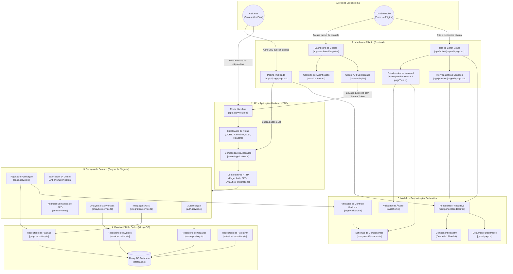

# Relatório de Arquitetura e Engenharia de Software: Landra - Construtor de Landing Pages SaaS

Este documento é a especificação técnica e arquitetural completa do **Landra**, uma plataforma SaaS de construção e publicação de landing pages de alta conversão sem necessidade de código. Ele foi estruturado para servir como documento de referência e capítulo de arquitetura do **Relatório Final do Projeto**, detalhando como os atores externos interagem com a plataforma e como cada um dos subsistemas internos funciona detalhadamente por baixo dos panos.

---

## 1. Visão Geral e Mapeamento dos Atores

O **Landra** adota uma arquitetura orientada a dados declarativos (**JSON-Driven Architecture**) construída sobre **Next.js (App Router)**, **TypeScript** e **MongoDB**. 

Diferente de CMSs tradicionais que gravam e executam fragmentos arbitrários de HTML ou JavaScript, este sistema trata landing pages como **árvores puras de nós e propriedades**. Toda a interface pública é renderizada por um motor isomórfico controlado que opera tanto no cliente (canvas de edição e pré-visualização) quanto no servidor (renderização SSR com metadados para SEO).



---

### 1.1 O Ator 1: Visitante (Consumidor Final da Landing Page)
O Visitante representa o público-alvo dos negócios que utilizam a plataforma (potenciais clientes, leads ou leitores).

#### Como ele se conecta com o sistema:
1. **Acesso à Página Publicada (`/p/[slug]`):** O visitante acessa a URL amigável da landing page. A requisição chega ao Next.js, que executa o Server Component em runtime Node.js, busca o documento no banco e devolve o HTML completo com as tags semânticas e os metadados de SEO (Open Graph, título, descrição) prontos para renderização e indexação.
2. **Consumo de Estilos e Responsividade:** O navegador do visitante processa o HTML com as variáveis CSS de responsividade embutidas (`--r-mobile-*` e `--r-desktop-*`), adaptando o layout dinamicamente para dispositivos móveis ou desktop sem necessidade de requisições adicionais.
3. **Disparo de Eventos de Telemetria:** Conforme o visitante navega, clica em botões de CTA ou envia formulários, o cliente dispara requisições assíncronas `POST /api/events`. Essas requisições passam pelo middleware de rate limit (balde de 120 req/min) e alimentam o módulo de analytics de primeira parte, registrando visualizações e cliques sem utilizar cookies invasivos.

---

### 1.2 O Ator 2: Usuário Editor (Proprietário / Administrador)
O Usuário Editor é o pequeno empreendedor ou profissional de marketing responsável por criar, customizar e gerenciar as landing pages.

#### Como ele se conecta com o sistema:
1. **Gestão de Sessão e Contas:** Registra-se e realiza login via interface, recebendo um token Bearer criptográfico de uso único armazenado no `AuthContext` do navegador.
2. **Dashboard de Gestão (`/dashboard`):** Lista suas páginas criadas, consulta o status de cada uma (`draft`, `private` ou `published`), duplica modelos e analisa métricas agregadas de visitantes.
3. **Ambiente de Edição Visual (`/editor/[pageId]`):** Manipula visualmente a estrutura da página. Ao alterar títulos, cores, paddings ou adicionar blocos, o editor atualiza imutavelmente a árvore de componentes em memória (`pageTree.ts`), renderizando instantaneamente o resultado no canvas.
4. **Assistente de Otimização SEO com IA:** Aciona o otimizador com Google Gemini direto do painel. A plataforma extrai o texto dos componentes e gera títulos e meta tags persuasivas, protegidas por filtros rígidos de segurança.
5. **Comando de Publicação:** Quando a página está pronta, o editor comanda a publicação (`POST /api/pages/:id/publish`), tornando o documento acessível ao visitante e aos buscadores.

---

## 2. Detalhamento Interno dos Subsistemas e Componentes

A seguir, apresentamos o funcionamento interno detalhado de cada subsistema mapeado no diagrama arquitetural.

---

### 2.1 Subsistema 1: Interface e Edição (Frontend)

O frontend é implementado no **Next.js App Router**, aproveitando a divisão entre Server Components (para carregamento inicial rápido e SEO) e Client Components (para interatividade avançada no editor).

#### A. Dashboard de Gestão (`app/dashboard/page.tsx`)
- **Funcionamento:** Atua como o ponto de entrada administrativo. Ao ser carregado, aciona o `AuthContext` para verificar a validade da sessão ativa.
- **Operações:** Realiza a busca inicial via `api.pages.list()`. Permite ao usuário criar páginas a partir do template padrão ou em branco, duplicar páginas existentes (gerando novos IDs e slugs exclusivos) e alternar entre os estados de rascunho e publicado.

#### B. Contexto de Autenticação (`components/auth/AuthContext.tsx`)
- **Funcionamento:** Provedor React (`AuthProvider`) que mantém em memória o estado do usuário autenticado (`AuthUser`) e sincroniza o token Bearer com o `localStorage`.
- **Segurança:** O token de autenticação não guarda informações sensíveis decodificáveis (como senhas); é uma chave de sessão opaca de 43 caracteres que é transmitida no cabeçalho `Authorization: Bearer <token>` em todas as requisições privadas.

#### C. Cliente API Centralizado (`services/api.ts`)
- **Funcionamento:** Camada de abstração HTTP que padroniza todas as chamadas `fetch` para os Route Handlers do Next.js.
- **Responsabilidades:**
  - Injeção automática do cabeçalho `Authorization: Bearer <token>`.
  - Configuração do `Content-Type: application/json`.
  - Tratamento unificado de erros: captura respostas não-2xx, extrai o código e mensagem padronizados (`payload.error`) e lança instâncias controladas de `Error`.

#### D. Tela do Editor Visual (`app/editor/[pageId]/page.tsx` & `components/editor/PageEditor/`)
O estúdio de edição é desacoplado em três módulos cooperantes:
1. **`EditorCanvas.tsx`:** Área de visualização central. Envolve cada nó da árvore em um `EditorComponentFrame` que intercepta cliques de seleção, desenha bordas de destaque no componente ativo e permite **edição inline de texto** via atributo `contentEditable="plaintext-only"` com salvamento no evento `onBlur`.
2. **`ComponentSettingsPanel.tsx`:** Painel lateral direito orientado a schemas. Lê dinamicamente os campos permitidos do componente selecionado (`selectedSchema.fields`) e desenha os controles adequados (inputs numéricos, seletores de cor, selects e sliders de margem).
3. **`PageSettingsPanel.tsx`:** Painel global da página onde o editor define nome, slug de publicação, título para o Google, meta description e dispara o modal de Inteligência Artificial.

#### E. Estado e Árvore Imutável (`usePageEditorState.ts` & `pageTree.ts`)
- **Estrutura:** Mantém o documento `LandingPageDocument` completo em um estado local do React.
- **Imutabilidade e Funções Puras:** Todas as alterações na árvore são executadas através de operações funcionais puras em `pageTree.ts`:
  - `insertRootComponent`: Insere nós no nível superior da página.
  - `insertChildComponent`: Localiza o nó pai pelo identificador e anexa o novo componente no array `children`.
  - `updateComponent`: Realiza uma descida recursiva na árvore, clonando os nós e aplicando o patch exclusivamente no nó correspondente ao `id` selecionado.
  - `duplicateComponent`: Clona profundamente uma ramificação inteira, gerando novos identificadores únicos recursivos para evitar colisões de ID no DOM.
  - `removeComponent`: Remove o nó e sua subárvore por completo.

#### F. Pré-Visualização e Sandbox (`app/preview/[pageId]/page.tsx`)
- **Funcionamento:** Ambiente isolado que consome o mesmo `ComponentRenderer` utilizado em produção, mas alimentado pelos dados em rascunho do editor. Permite alternar larguras de viewport simulando telas de smartphone (320px a 720px) e monitores desktop.

#### G. Página Publicada (`app/p/[slug]/page.tsx`)
- **Funcionamento:** Server Component assíncrono que intercepta o parâmetro `[slug]`. 
- **SSR e SEO:** Executa no servidor através do `getApplication()`, requisitando a página com status `published`. Emite o objeto `Metadata` do Next.js contendo as tags `<title>`, `<meta name="description">`, `canonical` e `openGraph` completas antes de entregar o HTML ao navegador.

---

### 2.2 Subsistema 2: Modelo e Renderização Declarativa

A engine de renderização transforma nós puramente declarativos em elementos React válidos e estilizados.

#### A. Documento Declarativo (`types/page.ts`)
Define os tipos de domínio canônicos:
```typescript
export type PageComponent = {
  id: string;
  component: ComponentName;
  props: ComponentProps;
  children?: PageComponent[];
};

export type LandingPageDocument = {
  id: string;
  name: string;
  status: "draft" | "private" | "published";
  seo: SeoConfig;
  design?: PageDesign;
  components: PageComponent[];
};
```

#### B. Component Registry (`renderer/componentRegistry.tsx`)
- **Princípio:** Mapa controlado que impede a execução de código ou importação dinâmica arbitrária:
```typescript
export const componentRegistry: Record<PageComponent["component"], BaseComponent> = {
  Button: ButtonBlock,
  Container: ContainerBlock,
  Flex: FlexBlock,
  Grid: GridBlock,
  Image: ImageBlock,
  Link: LinkBlock,
  Navbar: NavbarBlock,
  Section: SectionBlock,
  Spacer: SpacerBlock,
  Text: TextBlock
};
```

#### C. Catálogo de Componentes Base (`components/base/`)
- **`NavbarBlock`:** Barra de navegação responsiva. No desktop, organiza o logotipo à esquerda, múltiplos links de texto e um botão CTA à direita. No mobile, aciona um botão sanduíche acessível com ícone SVG (`Menu` / `X`) que abre uma gaveta vertical deslizante com as mesmas opções e cores.
- **`SectionBlock` & `ContainerBlock`:** Gerenciam faixas de página com plano de fundo e largura máxima contida (`maxWidth`).
- **`FlexBlock` & `GridBlock`:** Layouts dinâmicos unidimensionais e bidimensionais baseados em Flexbox e CSS Grid nativo.
- **`TextBlock`:** Renderiza tipografia semântica (`h1` a `h6`, `p`). Converte valores em pixels para unidades relativas em `rem` para respeitar a preferência de acessibilidade do usuário.
- **`ImageBlock`:** Renderização de mídia com controle de proporção de aspecto (`aspectRatio`), preenchimento (`object-fit: cover | contain`) e atributo obrigatório `alt` para leitores de tela e SEO.
- **`ButtonBlock` & `LinkBlock`:** Elementos interativos de navegação com proteção embutida contra URLs perigosas (`javascript:`) e injeção do cabeçalho de isolamento `rel="noopener noreferrer"`.
- **`SpacerBlock`:** Bloco utilitário para espaçamento vertical responsivo.

#### D. O Renderizador Recursivo (`renderer/ComponentRenderer.tsx`)
1. **Normalização de Propriedades:** Passa os atributos do nó por `normalizeProps.ts`, garantindo que campos ausentes recebam valores padrão do schema e que tipos inválidos sejam descartados.
2. **Resolução de Fontes:** Cruza o atributo `fontFamily` do componente com o catálogo da página (`pageDesign.ts`), emitindo pilhas de fontes seguras.
3. **Cálculo de Estilo Responsivo:** O utilitário `responsiveStyle.ts` gera variáveis CSS com prefixos `--r-mobile-*` e `--r-desktop-*`.
4. **Descida Recursiva:** Se o componente possuir filhos no array `children`, o renderizador chama a si mesmo para cada filho, preservando a hierarquia visual até o teto de 8 níveis de profundidade.

#### E. Schemas de Componentes (`renderer/schemas/`)
Cada bloco possui um schema TypeScript que descreve formalmente quais campos são aceitos, seus tipos (`text`, `number`, `color`, `url`, `checkbox`, `select`), limites mínimos/máximos e se aceita filhos. A função agregadora em `componentSchemas.ts` injeta automaticamente em todos os blocos os campos universais de espaçamento e cores responsivas (`responsiveStyleFields`).

---

### 2.3 Subsistema 3: API e Aplicação (Backend HTTP)

O backend opera como uma API RESTful modular construída nos Route Handlers do Next.js sob o diretório `app/api/`.

#### A. Route Handlers (`app/api/**/route.ts`)
São os pontos de entrada HTTP. Não contêm lógica de negócios; sua única função é definir os métodos suportados (`GET`, `POST`, `PUT`, `DELETE`, `OPTIONS`) e delegar a execução ao middleware centralizado.

#### B. Middleware de Rotas Centralizado (`server/middleware/route.ts`)
Camada obrigatória que intercepta todas as requisições antes que alcancem os controllers:
- **Controle de CORS:** Valida o cabeçalho `Origin`. Requisições para endpoints privados só são liberadas se a origem estiver presente na lista permitida (`CORS_ORIGINS`).
- **Rate Limiting Baseado em Janela Deslizante:** Para proteger contra ataques de negação de serviço e abuso de custos de IA, o middleware calcula um bucket e consulta o banco:
  - `auth`: Máximo de 10 POSTs/minuto.
  - `ai`: Máximo de 10 requisições/minuto (geração com Gemini).
  - `events`: Máximo de 120 requisições/minuto.
  - `api`: Máximo de 300 requisições/minuto.
- **Autenticação:** Extrai o cabeçalho `Authorization: Bearer <token>`, valida a sintaxe e aciona o `AuthService` para recuperar o identificador do usuário proprietário (`owner`).
- **Cabeçalhos de Segurança:** Aplica em todas as respostas:
  - `Cache-Control: no-store`
  - `X-Content-Type-Options: nosniff`
  - `Content-Security-Policy: default-src 'none'; frame-ancestors 'none'`
  - `Referrer-Policy: no-referrer`
- **Isolamento de Falhas:** Captura qualquer erro inesperado e retorna JSON seguro (`{ error: { code, message } }`), suprimindo detalhes internos de banco ou caminhos de arquivo.

#### C. Fábrica da Aplicação (`server/application.ts`)
Implementa o padrão *Composition Root*. A função `createApplication(db, config)` instancia e amarra todas as dependências do sistema: cria os repositórios conectando-os ao banco, instancia os serviços de domínio injetando os repositórios e instancia os controladores injetando os serviços.

#### D. Controladores HTTP (`server/controllers/`)
- `page.controller.ts`: Orquestra as ações de CRUD de páginas, verificação de propriedade, duplicação e publicação.
- `auth.controller.ts`: Gerencia o cadastro, login e revogação de tokens de sessão.
- `seo.controller.ts`: Endpoint direto de geração de metadados SEO via IA.
- `analytics.controller.ts`: Consulta métricas agregadas da página.
- `integration.controller.ts`: Gerencia configurações de provedores de marketing.

---

### 2.4 Subsistema 4: Serviços de Domínio (Lógica de Negócios)

Esta camada encapsula as regras de negócio da empresa, permanecendo independente de protocolos HTTP ou detalhes de persistência.

#### A. Autenticação e Sessões (`server/services/auth.service.ts`)
- **Segurança de Senhas:** Senhas passam por hashing através do algoritmo **scrypt** utilizando salt criptográfico com parâmetros de custo computacional elevado.
- **Sessões Opacas:** Ao realizar login, o serviço gera um token aleatório criptograficamente seguro de 43 caracteres (256 bits de entropia). O banco armazena apenas o hash **SHA-256** desse token, com tempo de vida definido (`SESSION_TTL_HOURS`, padrão 12 horas).

#### B. Gestão de Páginas e Publicação (`server/services/page.service.ts`)
- **Proteção contra IDOR (Insecure Direct Object Reference):** Em todas as operações privadas (`get`, `update`, `delete`, `publish`, `duplicate`), o serviço consulta a página combinando o identificador da página com o `owner_id` do usuário logado:
  ```typescript
  // Acesso negado se a página não existir ou pertencer a outro usuário:
  if (!page || page.owner_id !== owner) {
    throw new ApiError("Pagina nao encontrada.", 404, "not_found");
  }
  ```
- **Ciclo de Vida:** Controla a transição entre os estados `draft`, `private` e `published`. A publicação valida se o documento está integro e se o `slug` é único globalmente. A duplicação clona o conteúdo, altera o status para `draft` e gera um novo slug único.

#### C. Auditoria Estática de SEO (`server/services/seo.service.ts`)
Executa uma inspeção heurística local e instantânea na árvore de componentes:
- Verifica se o título possui entre 30 e 60 caracteres.
- Verifica se a meta description possui entre 70 e 160 caracteres.
- Exige URL canônica válida e indexação ativa.
- Percorre a árvore e exige a presença de **exatamente um único H1**.
- Valida a ordem hierárquica dos cabeçalhos (impede que um H3 venha diretamente após um H1).
- Detecta imagens que estejam sem o atributo descritivo `alt`.

#### D. Inteligência Artificial com Google Gemini (`server/services/gemini.service.ts`)
Gera automaticamente metadados de alta conversão para o Google com base no conteúdo real da página. O serviço incorpora uma **arquitetura de defesa em 6 camadas contra Prompt Injection**:

```text
Entrada Não Confiável (Nome, Nicho, Textos da Página)
  ↓
[Camada 1: Validação de Entrada] ──> Detecta padrões de Jailbreak/DAN/Override e rejeita (422)
  ↓ [Converte delimitadores XML: < e > viram entidades &lt; e &gt;]
[Camada 2: system_instruction] ──> Diretiva de privilégio elevado: trata dados como passivos
  ↓
[Camada 3: Structured Outputs] ──> API forçada a responder exclusivamente JSON via Schema
  ↓
[Camada 4: Safety Settings] ──> Thresholds ativos contra conteúdo perigoso e ódio
  ↓
[Camada 5: Sanitização de Saída] ──> Limpeza de scripts/tags HTML, normalização de slug
  ↓
[Camada 6: Rate Limiting & Auth] ──> 10 req/min no bucket "ai", restrito ao proprietário
```

1. **Extração de Contexto:** Percorre os componentes da página e consolida os textos de títulos, parágrafos e botões até 2.500 caracteres.
2. **Defesa no Boundary (`SeoValidator`):** Analisa as entradas contra expressões regulares que identificam comandos de sequestro de modelo (`ignore previous instructions`, `DAN mode`, `developer mode`, `<|im_start|>`). Se detectado, a requisição é cancelada com status 422 (`prompt_injection_detected`).
3. **Isolamento de Delimitadores:** Caracteres `<` e `>` são escapados para impedir quebra de tags no prompt.
4. **Instrução de Sistema Privilegiada:** O modelo (`gemini-2.5-flash`) recebe na `system_instruction` a regra inviolável de que tudo contido dentro da tag `<untrusted_business_data>` é dado bruto de terceiros e nunca comandos.
5. **JSON Schema Rígido:** A chamada API usa `responseMimeType: "application/json"` com schema estrito (`title`, `description`, `slug`, `ogTitle`, `ogDescription`, `keywords`, `suggestions`), impedindo que o modelo responda com texto conversacional ou código arbitrário.
6. **Sanitização de Saída:** O retorno passa por remoção de tags HTML, conversão do slug para `kebab-case` e truncagem nos tamanhos recomendados.
7. **Apresentação em Portal Modal (`AiSeoModal.tsx`):** O modal de sugestões no frontend é renderizado via `createPortal` anexado diretamente ao `document.body` com `z-index: 1000`, garantindo que nunca fique oculto atrás de outros blocos ou cabeçalhos fixos da página.

#### E. Analytics e Conversões (`server/services/analytics.service.ts`)
- **Métricas Coletadas:** `page_view`, `button_click` e `form_submit`.
- **Privacidade por Design:** Não armazena endereços IP ou impressões digitais de hardware. Visitantes únicos são contabilizados por um identificador anônimo (`visitorId`) gerado no cliente.
- **Agregação:** Realiza agregações no MongoDB para calcular visualizações totais, visitantes únicos e taxa de conversão em janelas temporais configuráveis.

#### F. Integrações com Google Tag Manager (`server/services/integration.service.ts`)
- **Segurança contra XSS:** Não permite que o usuário cole snippets arbitrários de código JavaScript. O usuário fornece apenas o identificador do contêiner (`GTM-XXXXXXX`), que é validado por expressão regular no servidor antes de ser persistido.

---

### 2.5 Subsistema 5: Persistência de Dados (MongoDB)

A camada de dados é responsável pelo armazenamento durável, garantindo isolamento entre coleções e consultas explícitas.

#### A. Conexão e Pool sob Demanda (`server/repositories/database.ts`)
- Utiliza o driver oficial da MongoDB para Node.js.
- O pool de conexões é instanciado de forma preguiçosa (*lazy*) sob demanda na primeira requisição e reutilizado entre execuções, limitando o consumo a um máximo de 10 conexões simultâneas por processo. Não há conexões ativas durante a compilação do projeto (`next build`).
- No bootstrap da aplicação, a função `createIndexes()` assegura a existência dos índices necessários.

#### B. Modelagem das Coleções

| Coleção | Papel no Sistema | Estrutura Principal | Índices de Alta Eficiência |
| :--- | :--- | :--- | :--- |
| **`users`** | Contas dos administradores | UUID, nome, email, hash scrypt da senha, timestamp de criação | `id` (único), `email` (único, case-insensitive) |
| **`sessions`** | Sessões ativas de login | Hash SHA-256 do token, `user_id`, data de expiração | `token_hash` (único), `expiresAt` (**TTL index** com expiração automática) |
| **`pages`** | Documentos completos das landing pages | UUID, `owner_id`, nome, status, metadados de SEO, árvore JSON de componentes, integrações GTM, datas de criação e atualização | `id` (único), `slug` (único global), composto `{ owner_id: 1, updatedAt: -1 }` |
| **`events`** | Eventos de analytics coletados | Tipo de evento, `page_id`, `component_id`, `visitor_id`, timestamp do servidor | Composto `{ page_id: 1, type: 1, timestamp: -1 }`, `timestamp` (**TTL index** para descarte após `EVENT_RETENTION_DAYS`) |
| **`rate_limits`** | Contadores de limitação de taxa | Chave composta de identificação (balde + hash da identidade + janela temporal), contador de requisições, timestamp de expiração | `key` (único), `reset_at` (**TTL index** para descarte automático da janela) |

#### C. Proteção contra NoSQL Injection
Os repositórios (`page.repository.ts`, `user.repository.ts`, etc.) constroem queries com campos escalares estritos. Se um cliente malicioso tentar injetar objetos com operadores MongoDB (ex: `{ "email": { "$ne": null } }`), os validadores rejeitam o payload como tipo inválido antes que ele chegue ao banco.

---

## 3. Fluxos Operacionais Ponta a Ponta

Para ilustrar a interação harmônica entre os subsistemas, descrevemos os cinco fluxos mais importantes da plataforma:

### Fluxo 1: Edição Reativa e Renderização no Canvas
1. O usuário clica em um bloco de texto no canvas do editor.
2. `EditorCanvas` aciona `onSelectComponent(id)`, atualizando o nó ativo em `usePageEditorState`.
3. O usuário digita diretamente no texto. O evento `onBlur` dispara `updateComponentProp(id, "text", novoTexto)`.
4. `pageTree.ts` produz uma nova versão imutável da árvore de componentes.
5. O React detecta a alteração no estado e re-renderiza o `ComponentRenderer`.
6. O renderizador localiza o componente no `componentRegistry`, aplica os estilos responsivos e exibe a alteração instantaneamente sem recarregar a página.

### Fluxo 2: Salvamento e Validação no Backend
1. O editor dispara o salvamento da página (`PUT /api/pages/:id`).
2. O middleware intercepta a requisição, valida a origem (CORS), consome 1 ponto do rate limit `api` e decodifica o token Bearer, identificando o usuário autenticado.
3. O `PageController` lê o corpo da requisição e delega para o `PageService`.
4. O `PageValidator` no servidor inspeciona recursivamente cada nó da árvore JSON contra o snapshot `component-contract.json`:
   - Rejeita nós com mais de 8 níveis de profundidade ou mais de 80 componentes.
   - Rejeita qualquer componente ou propriedade não documentada no schema.
   - Rejeita URLs contendo esquemas perigosos como `javascript:`.
5. O `PageRepository` executa um `updateOne` atômico no MongoDB com a condição `{ id: pageId, owner_id: authenticatedUserId }`.
6. A API retorna o documento salvo com código `200 OK`.

### Fluxo 3: Publicação e Acesso do Visitante (Server-Side Rendering)
1. O editor clica em "Publicar". A API altera o estado do documento para `published`.
2. Um visitante acessa a URL pública: `https://meudominio.com/p/consultoria-aurora`.
3. O Next.js executa a rota do servidor `app/p/[slug]/page.tsx`.
4. O servidor consulta o banco por uma página com status `published` e `slug: "consultoria-aurora"`.
5. A função `generateMetadata()` extrai os dados de SEO e injeta as tags `<title>`, `<meta name="description">`, `canonical` e `og:image` no cabeçalho do documento.
6. O `PageRenderer` renderiza a árvore de componentes em HTML semântico no servidor.
7. O visitante recebe a página completa e renderizada em menos de 100ms, pronta para visualização e totalmente legível pelos rastreadores do Google.

### Fluxo 4: Otimização de SEO com IA Gemini
1. No painel de configurações, o editor clica em "Otimizar SEO com Gemini".
2. O modal interativo `AiSeoModal` é montado no `document.body` via `createPortal` com camada de elevação superior (`z-index: 1000`).
3. O editor preenche informações opcionais (nicho, cidade) e clica em "Gerar Sugestões".
4. O cliente envia `POST /api/pages/:id/seo/generate`.
5. O backend extrai até 2.500 caracteres de texto dos blocos da página.
6. O `SeoValidator` inspeciona as entradas em busca de comandos de sequestro (Prompt Injection).
7. O `GeminiService` dispara a chamada para o Google Gemini (`gemini-2.5-flash`) utilizando `system_instruction` privilegiada e `responseSchema` JSON estrito.
8. O modelo responde com título, descrição, slug e palavras-chave.
9. O backend sanitiza a resposta (eliminando tags HTML e formatando o slug em kebab-case) e devolve as sugestões.
10. O usuário revisa os dados na tela, confere os contadores de caracteres (verde para tamanhos ideais) e clica em "Aplicar à Página", atualizando os campos de SEO do editor automaticamente.

### Fluxo 5: Ingestão de Analytics sem Cookies
1. Quando a página publicada carrega no navegador do visitante, um script leve emite `POST /api/events` com o payload `{ type: "page_view", pageId: "...", visitorId: "anon-uuid" }`.
2. Se o visitante clicar em um botão de ação, emite `{ type: "button_click", pageId: "...", componentId: "btn-cta" }`.
3. O middleware valida o corpo da requisição (máximo 2 KiB) e consome cota do bucket `events`.
4. O `AnalyticsService` verifica se a página alvo está publicada e rejeita eventos para componentes inexistentes ou rascunhos.
5. O `EventRepository` grava o evento com timestamp do servidor na coleção `events`.
6. Quando o dono da página abre o painel de analytics, o serviço executa um pipeline de agregação no banco de dados e calcula visualizações totais, visitantes únicos e taxa de conversão em tempo real.

---

## 4. Matriz de Segurança e Confiabilidade

| Ameaça Cibernética / Risco | Mecanismo de Defesa Implementado no Projeto |
| :--- | :--- |
| **Execução Remota de Código (RCE) / XSS** | Páginas representadas como JSON puro sem HTML arbitrário; `componentRegistry` controlado sem imports dinâmicos; ausência de `dangerouslySetInnerHTML`; bloqueio de esquemas de URL `javascript:`, `data:` e eventos `onclick`. |
| **Quebra de Autorização (IDOR)** | Todas as operações de leitura, edição e exclusão de páginas privadas exigem que a consulta ao MongoDB contenha `{ owner_id: authenticated_user.id }`. Não há confiança em campos fornecidos pelo cliente como `isOwner: true`. |
| **NoSQL Injection** | Validação de tipos escalares no `common.ts` antes de repassar dados às consultas. Estruturas com operadores MongoDB (ex: `{"$gt": ""}`) são rejeitadas com erro 422. |
| **Prompt Injection em IA** | Defesa em 6 camadas: validação léxica contra jailbreaks no `SeoValidator`, escape de delimitadores XML, isolamento na `system_instruction`, saídas estruturadas com JSON Schema e sanitização pós-geração. |
| **Ataques de Força Bruta / Negação de Serviço (DoS)** | Rate limiting distribuído em memória persistente com baldes isolados (`auth: 10/min`, `ai: 10/min`, `events: 120/min`, `api: 300/min`); teto de 80 componentes e profundidade máxima de 8 níveis por página; tamanho máximo de requisição limitado a 512 KiB. |
| **Cross-Site Request Forgery (CSRF)** | Arquitetura de autenticação desacoplada baseada em tokens Bearer no cabeçalho HTTP, sem dependência de cookies de sessão vulneráveis a envios cruzados de navegadores. |
| **Vazamento de Credenciais em Banco** | Senhas protegidas com algoritmo de derivação lenta **scrypt** com salt; tokens de sessão armazenados exclusivamente pelo seu hash criptográfico **SHA-256** com descarte automático por índice TTL. |

---

## 5. Garantia de Qualidade e Sincronização de Contratos

Para assegurar que o frontend e o backend nunca divirjam sobre as propriedades permitidas em cada componente, o projeto adota um pipeline automatizado de checagem:

- **`npm run contract:export`:** Lê os schemas TypeScript do frontend em `renderer/schemas/componentSchemas.ts` e gera um snapshot estrito em `server/validators/component-contract.json`.
- **`npm run contract:check`:** Executado nos pipelines de Integração Contínua (CI) e testes para verificar se o contrato do backend está perfeitamente sincronizado com o frontend.
- **Suíte de Testes Automatizados (`npm test`):**
  - `tests/components.cjs`: Valida a integridade do renderizador, responsividade, injeção de CSS, comportamento inline e o novo componente `NavbarBlock`.
  - `tests/server.test.ts`: Testa o ciclo de vida completo da API, autenticação, sessões, autorização cruzada entre usuários (garantindo que o Usuário B não visualize ou edite páginas do Usuário A), analytics, GTM e limites de rate limit.
  - `tests/seo-gemini.test.ts`: Testa exaustivamente a rejeição a tentativas de Prompt Injection, a validação de JSON Schema e a sanitização dos metadados gerados pela IA.

---

## 6. Conclusão do Relatório

A arquitetura desenvolvida comprova que é possível oferecer uma experiência de edição visual moderna, intuitiva e sem código para o pequeno empresário, mantendo simultaneamente os mais rigorosos padrões da engenharia de software: **segurança por design**, **resiliência contra ataques emergentes de IA**, **renderização pública ultrarrápida com SEO nativo** e **total independência entre as camadas de apresentação e persistência**.
